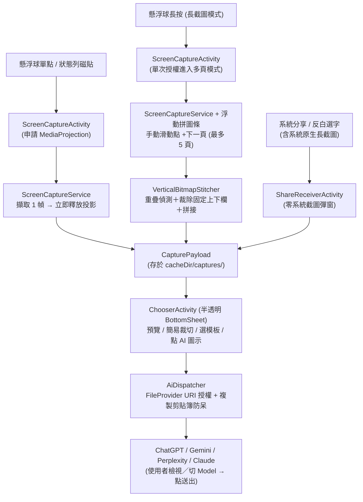

# TrueFind（Android MVP）開發設計規格書

- **文件日期**：2026-11-20
- **目標平台**：Android（`minSdk = 29` / Android 10+，`targetSdk = 35` / Android 15）
- **上架目標**：公開上架 Google Play 商店（嚴格遵循 Play 權限與隱私政策）
- **相關畫面分鏡**：[truefind-storyboard.html](../../mockups/truefind-storyboard.html)

---

## 1. 產品定位與範圍界定

### 1.1 核心價值
使用者在手機瀏覽社群貼文（Threads、Facebook、Instagram、X、Line、新聞網頁等）時，常需要將當下看到的圖文轉交給自己已訂閱的 AI App（如 ChatGPT、Gemini）進行事實查核，卻必須手動截圖／複製、切換 App、上傳圖片、重複輸入查核指令。

**TrueFind** 是一款零 API 費用、零網路權限、純本機運作的 Android 快捷查核工具：
- 透過**懸浮快捷球**、**狀態列快捷磁貼**、**系統分享**與**反白選字**快速擷取當下畫面（支援單張截圖與捲動長截圖）或文字。
- 在半透明底部選擇面板一鍵套用事實查核 Prompt 模板，並直接將內容派發到手機已安裝的 ChatGPT / Gemini / Perplexity / Claude / Grok 等原生 AI App，延續使用者既有的訂閱額度與聯網搜尋能力。

### 1.2 MVP v1.0 功能範圍（In-Scope）
1. **四大內容擷取入口**：
   - 懸浮快捷球（單點：單張截圖；長按：捲動拼圖長截圖）。
   - 狀態列快捷磁貼（Quick Settings Tile，免開懸浮球亦可一鍵觸發）。
   - 系統分享接收（`ACTION_SEND`：文字、連結、單張／系統原生捲動長截圖）。
   - 反白選字選單（`ACTION_PROCESS_TEXT`：選取貼文文字直接進面板，零系統截圖彈窗）。
2. **捲動長截圖（手動捲動拼圖模式，Google Play 合規）**：
   - 在單次 `MediaProjection` 授權內連續擷取多頁（最多 5 頁），本機自動偵測重疊區域並無縫拼接為一張清晰長圖。
3. **查核選擇面板（`ChooserActivity`）**：
   - 截圖縮圖預覽＋可選簡易裁切（去除聊天室頭像、狀態列等個資或無關區塊）。
   - 4 組預設繁體中文查核模板（可自訂新增／編輯／刪除）與臨時微調框。
   - 動態偵測已安裝 AI App 圖示列，單點圖示即完成派發。
4. **原生 AI App 派發引擎**：
   - 透過 `FileProvider` 單次授權傳圖與 `EXTRA_TEXT` 帶入指令。
   - 派發前自動將組合好的 Prompt 同步複製到剪貼簿並提示，防止部分 AI App 版本忽略 `EXTRA_TEXT`。
5. **主設定與權限引導頁（`MainActivity`）**：
   - 懸浮球開關與權限狀態檢查（懸浮窗權限、通知權限、新增狀態列磁貼引導）。
   - 查核 Prompt 模板管理與預設模板重置。

### 1.3 明確排除項目（Non-Goals for v1.0）
- **不串接第三方 LLM API / BYOK**：v1.0 完全吃手機現有 AI App 訂閱；不申請 `INTERNET` 權限。
- **不使用 `AccessibilityService`（無障礙服務）**：不自動捲動其他 App、不模擬點擊送出鍵，確保 100% 通過 Google Play 審查。
- **不程式強制指定 Model**：原生 AI App 未開放透過 Share Intent 指定模型，使用者切進目標 App 後可在該 App 頂部隨手切換 Model 再按送出。
- **不做數位助理模式（`VoiceInteractionService`）**：保留於 v1.1+ 作為進階選配，不納入 MVP。
- **不做帳號登入、雲端同步、查核歷史資料庫**：截圖僅存在 App 私有快取並定期自動清除。

---

## 2. 技術選型與專案結構

### 2.1 技術棧
- **語言**：Kotlin 2.x
- **UI 框架**：Jetpack Compose + Material 3（同時用於 `MainActivity` 與透明底部彈窗 `ChooserActivity`）
- **建置系統**：Gradle Kotlin DSL（`build.gradle.kts` + Version Catalog `libs.versions.toml`）
- **SDK 設定**：`compileSdk = 35`、`targetSdk = 35`、`minSdk = 29`
- **本機儲存**：Android 內建 `SharedPreferences` + `org.json`（僅存偏好設定與 Prompt 模板清單，不引入 Room / DataStore / Hilt 等重型依賴）
- **圖片處理與長截圖拼接**：Android 原生 `Bitmap` / `Canvas` + 純 Kotlin 重疊比對演算法（不引入 OpenCV）
- **非同步處理**：Kotlin Coroutines（`Dispatchers.Default` 處理拼接與縮圖、`Dispatchers.IO` 處理檔案讀寫）

### 2.2 模組與套件結構
```text
app/src/main/java/com/truefind/app/
├── TrueFindApp.kt                   # Application 與輕量手動依賴容器 AppContainer
├── model/
│   ├── CapturePayload.kt            # 跨模組統一內容載體
│   ├── PromptTemplate.kt            # Prompt 模板資料模型與預設模板定義
│   └── AiTargetApp.kt               # 支援的 AI App 定義與能力標記
├── data/
│   ├── SettingsStore.kt             # SharedPreferences 封裝（懸浮球狀態、上次模板）
│   ├── PromptTemplateRepository.kt  # Prompt 模板 CRUD 與 org.json 序列化
│   └── CaptureCacheManager.kt       # cacheDir/captures/ 寫入、FileProvider URI、過期清理
├── capture/
│   ├── FloatingBubbleService.kt     # 懸浮球與捲動拼圖浮動控制列 (WindowManager)
│   ├── FactCheckTileService.kt      # 下拉狀態列快捷磁貼 (TileService)
│   ├── ScreenCaptureActivity.kt     # 透明中繼頁：向系統申請 MediaProjection 權限
│   ├── ScreenCaptureService.kt      # FOREGROUND_SERVICE_TYPE_MEDIA_PROJECTION 單次／多頁擷取
│   └── ShareReceiverActivity.kt     # 承接 ACTION_SEND 與 ACTION_PROCESS_TEXT
├── stitch/
│   ├── OverlapFinder.kt             # 純 Kotlin 灰階陣列重疊搜尋演算法（零 Android 依賴，可直接 JVM 單測）
│   └── VerticalBitmapStitcher.kt    # Android Bitmap／Canvas 裁切與無縫拼接封裝
├── chooser/
│   ├── ChooserActivity.kt           # 半透明 ModalBottomSheet 查核選擇面板
│   ├── ChooserSheetContent.kt       # 縮圖、模板 Chips、Prompt 微調框、AI 圖示列 UI
│   └── CropOverlayDialog.kt         # 簡易拖曳框選裁切元件
├── dispatch/
│   ├── AiAppRegistry.kt             # 透過 PackageManager + <queries> 偵測已安裝 AI App
│   ├── PromptComposer.kt            # 依截圖或純文字組裝最終 Prompt
│   └── AiDispatcher.kt              # Explicit ACTION_SEND 派發、URI 授權、剪貼簿防呆
└── settings/
    ├── MainActivity.kt              # 主設定頁與權限引導
    └── TemplateEditorSheet.kt       # 新增／編輯查核模板介面
```

---

## 3. 核心資料契約與系統流程

### 3.1 統一資料模型（`CapturePayload`）
所有擷取入口產出的結果一律轉換為不可變的 `CapturePayload`，透過 Intent Extra 傳入 `ChooserActivity`，徹底解耦「擷取方式」與「派發邏輯」：

```kotlin
enum class CaptureSource {
    SINGLE_SCREENSHOT,   // 懸浮球單點或狀態列磁貼單張截圖
    SCROLL_STITCH,       // 手動捲動拼圖長截圖
    SHARE_IMAGE,         // 系統分享圖片（含系統原生長截圖）
    SHARE_TEXT,          // 系統分享文字／網址
    PROCESS_TEXT         // 反白選字選單
}

data class CapturePayload(
    val imageFilePath: String?, // 指向 cacheDir/captures/ 下的 PNG（純文字時為 null）
    val text: String?,          // 分享或選取的文字／網址（截圖時為 null）
    val source: CaptureSource,
    val frameCount: Int = 1     // 長截圖拼接頁數（單張為 1）
)
```

### 3.2 端到端系統資料流


---

## 4. 各模組詳細設計

### 4.1 觸發與螢幕擷取（`capture/`）

#### A. 懸浮球（`FloatingBubbleService`）
- 使用 `WindowManager.LayoutParams.TYPE_APPLICATION_OVERLAY` 顯示半透明圓形按鈕（48dp，預設靠右吸附）。
- **手勢與互動**：
  - **單點**：立即隱藏懸浮球（延遲 150ms 確保螢幕重繪不含懸浮球）→ 啟動 `ScreenCaptureActivity(mode = SINGLE)`。
  - **長按（≥ 400ms，附微震動回饋）**：立即隱藏懸浮球 → 啟動 `ScreenCaptureActivity(mode = SCROLL_STITCH)` 進入手動捲動拼圖模式。
  - **拖曳**：放開後自動貼齊螢幕左側或右側邊緣並記憶 Y 座標；拖至螢幕下方「✕ 關閉」靶區即關閉服務。
- 服務執行期間顯示低干擾靜音前景通知（`FOREGROUND_SERVICE_TYPE_SPECIAL_USE`，附「關閉懸浮球」快捷動作按鈕）。

#### B. 狀態列快捷磁貼（`FactCheckTileService`）
- 繼承 `TileService`，使用者可自訂加入 Android 下拉控制中心。
- 點擊時收合狀態列並啟動 `ScreenCaptureActivity(mode = SINGLE)`（Android 14+ 使用 `startActivityAndCollapse(PendingIntent)`）。
- 進入 `ScreenCaptureActivity` 前延遲 350ms 等待狀態列收合動畫完成，避免截到下拉選單。

#### C. 單次與多頁螢幕擷取（`ScreenCaptureActivity` + `ScreenCaptureService`）
- `ScreenCaptureActivity` 為 `Theme.Translucent.NoTitleBar`，呼叫 `MediaProjectionManager.createScreenCaptureIntent()`。
- 使用者點「立即開始」後，將 `resultCode` 與 `data` 交給 `ScreenCaptureService`（必須先呼叫 `startForeground(..., FOREGROUND_SERVICE_TYPE_MEDIA_PROJECTION)` 再呼叫 `getMediaProjection()`，以符合 Android 14+ 強制順序）。
- **單張模式（`SINGLE`）**：
  - 建立 `VirtualDisplay` 與 `ImageReader(width, height, PixelFormat.RGBA_8888, 2)`。
  - 取得第一幀有效畫面 → 偵測是否為全黑保護畫面 → 寫入 `cacheDir/captures/cap_<ts>.png` → **立即釋放 `VirtualDisplay`、`ImageReader`、`MediaProjection` 並 `stopSelf()`** → 啟動 `ChooserActivity` 並恢復懸浮球。
- **捲動拼圖模式（`SCROLL_STITCH`）**：
  - 取得第 1 幀後**維持同一筆 `MediaProjection` 與 `VirtualDisplay` 開啟**（因此使用者不需重複點 Android 14+ 系統確認窗），在螢幕側邊／底部顯示精簡浮動控制列（**不遮擋中央閱讀區**）：
    - `[ + 擷取下一頁 (1/5) ]`　`[ ✓ 完成拼接 ]`　`[ ✕ 取消 ]`
  - 使用者用手指照常往下捲動貼文（留約 15–30% 重疊畫面即可）→ 點 `+ 擷取下一頁` → 控制列暫隱 120ms → 抓下下一幀 → 控制列恢復並更新計數 `(2/5)`。
  - 點 `✓ 完成拼接`（或達上限 5 頁，或閒置超時 60 秒安全保護）→ **立即釋放 `MediaProjection` 並停止前景服務** → 交由 `VerticalBitmapStitcher` 拼接 → 啟動 `ChooserActivity`。
- 必須註冊 `MediaProjection.Callback.onStop()`：若系統或使用者從狀態列中斷投影，立刻清理資源並恢復懸浮球，絕不殘留背景服務。

#### D. 系統分享與反白選字（`ShareReceiverActivity`）
- 支援以下 Intent Filters：
  - `ACTION_SEND` + `text/plain`（文字、貼文連結）
  - `ACTION_SEND` + `image/*`（任意圖片，包含 Android 12+ 系統內建「捲動截圖」完成後直接按分享送來的長圖）
  - `ACTION_PROCESS_TEXT` + `text/plain`（註冊名稱「TrueFind 查核」，支援 `EXTRA_PROCESS_TEXT` 唯讀選字）
- 若為分享圖片，複製串流至 `cacheDir/captures/`（確保後續 `ChooserActivity` 與 `FileProvider` 擁有穩定本地檔），隨即啟動 `ChooserActivity` 並 `finish()`。

---

### 4.2 捲動長截圖拼接引擎（`stitch/VerticalBitmapStitcher.kt`）

#### 為何採「手動捲動拼圖＋系統長截圖連動」？
在 Android 平台上，第三方 App 若要「自動幫使用者滑動 Threads／FB／Line」必須使用 `AccessibilityService.dispatchGesture()`，這會直接違反 Google Play 無障礙政策遭拒審。本設計以兩種 100% 合規的方式完整滿足長文查核需求：
1. **內建手動捲動拼圖**：單次授權內自行滑動＋點一下加頁，由本機演算法自動無縫接合。
2. **系統原生長截圖接手**：直接接收各品牌 Android 內建捲動截圖的分享結果。

#### 純 Kotlin 無縫拼接演算法規格
輸入：`frames: List<Bitmap>`（2～5 張相同解析度的螢幕截圖），`statusBarHeightPx`、`navBarHeightPx`。

1. **排除固定介面干擾帶（Static Chrome Masking）**：
   - 手機畫面的頂部狀態列／App 標題列與底部導覽列／輸入列在捲動時通常固定不動。
   - 比對重疊區時，忽略每張圖頂部 `topIgnore = max(statusBarHeightPx, height * 0.14)` 與底部 `bottomIgnore = max(navBarHeightPx, height * 0.14)`，僅使用中間主內容帶進行匹配。
2. **快速灰階降採樣重疊搜尋**：
   - 將每張圖內容帶寬度縮放至 `180px` 並轉為 8-bit 灰階陣列（運算耗時 < 40ms／組，無需 OpenCV）。
   - 取上一張圖內容帶最底端高度 `templateH = contentH * 0.18` 作為模板條，在下一張圖內容帶內由上往下滑動搜尋（搜尋範圍：`overlap` 佔內容高度 8%～85%），計算像素平均絕對誤差（MAD，正規化至 `0.0..1.0`）。
3. **拼接決策與防呆回退**：
   - **高信心匹配（`bestMad < 0.08`）**：判定為有效重疊。保留第 1 張的頂部至接縫處、中間各張僅取不重疊的新增內容帶、最後一張保留至底部（自然消除重複的狀態列與導覽列）。
   - **低信心（`bestMad >= 0.08`，例如使用者滑太快完全沒重疊）**：不強行裁切以免遺漏文字，改採「切除中間固定狀態列／導覽列後垂直相接，並在接縫處畫一條 4px 淺灰分隔線」。
4. **畫質與記憶體上限保護**：
   - 若單張原始寬度 > 1080px，先等比縮放寬度至 `1080px`（確保長圖在 ChatGPT / Gemini 壓縮後中文小字仍清晰可讀）。
   - 總高度上限 `6000px`（若超過則等比縮放），並於每一步完成後主動 `recycle()` 中間暫存 `Bitmap`，防範 OOM。

---

### 4.3 查核選擇面板與簡易裁切（`chooser/`）

- **`ChooserActivity`**：透明主題 Activity（背景 45% 黑半透明遮罩），進場直接呈現 Material 3 `ModalBottomSheet`（點擊外部遮罩或按返回鍵即取消關閉）。
- **面板區塊由上而下**：
  1. **標題列**：`TrueFind 事實查核` ＋ 若為截圖則右側顯示 `✂ 裁切範圍` 按鈕（若為長截圖額外顯示徽章如 `已拼接 3 頁`）。
  2. **內容預覽區**：
     - 截圖模式：顯示可點擊放大預覽的縮圖卡片（長截圖顯示垂直捲動預覽）。
     - 文字模式：顯示最多 3 行節錄文字（點擊可展開全文）。
  3. **查核模板 Chips（橫向滑動）**：
     - 預設內建 4 組繁體中文模板，自動選中上次使用的模板：
       - **事實查核（預設）**：`請幫我對以下內容進行事實查核：1) 列出主要宣稱；2) 逐項查證真偽並附上可靠來源或依據；3) 給出簡短總結（可信／部分錯誤／不實／缺乏證據）。請用繁體中文回答。`
       - **找原始出處**：`請幫我追查這段說法、數據或圖片最早的原始出處、發布時間與完整脈絡，確認是否有移花接木或舊聞重炒。請用繁體中文回答。`
       - **查邏輯與偏誤**：`請分析這段內容的論述結構，指出其中是否有斷章取義、偷換概念、以偏概全、誇大數據或情緒操弄，並補充平衡觀點。請用繁體中文回答。`
       - **翻譯＋重點查證**：`請先將這段外文內容翻譯成繁體中文重點摘要，接著針對核心宣稱進行事實查核並標註可信度。`
  4. **Prompt 臨時微調框**：預設收合顯示 2 行預覽，點擊可展開編輯（例如臨時補一句「特別查第二段數字」），僅影響本次派發不改動原模板。
  5. **AI App 一鍵送出列**：橫向排列手機上實際已安裝的 AI App 圖示，最右側固定為「其他 App（系統分享）」。**點擊圖示立即派發並關閉面板**。
- **`CropOverlayDialog`**：簡潔全螢幕裁切遮罩，支援拖曳四邊／四角控制點裁切出貼文本體，按「完成」覆寫暫存截圖並返回選擇面板。

---

### 4.4 AI App 偵測與派發引擎（`dispatch/`）

#### A. 支援清單與 `<queries>` 白名單（`AiAppRegistry`）
於 `AndroidManifest.xml` 宣告 `<queries>`（絕不使用 `QUERY_ALL_PACKAGES`），依序偵測下列 App：

| 顯示名稱 | Android Package Name | 偵測方式 |
|---|---|---|
| ChatGPT | `com.openai.chatgpt` | `queryIntentActivities(ACTION_SEND, mimeType)` |
| Gemini | `com.google.android.apps.bard` | 同上 |
| Perplexity | `ai.perplexity.app.android` | 同上 |
| Claude | `com.anthropic.claude` | 同上 |
| Grok | `ai.x.grok` | 同上 |
| 其他 App | （系統分享選擇器保底） | `Intent.createChooser` |

- **能力相容檢查**：依目前 `CapturePayload` 是「圖片」還是「純文字」，分別查詢目標套件是否接受 `image/png` 或 `text/plain`。若某 AI App 版本僅支援文字而目前為截圖，將該圖示置灰並標註「僅支援文字」，避免派發失敗。

#### B. 派發實作細節（`AiDispatcher`）
1. **Prompt 組合（`PromptComposer`）**：
   - 截圖模式：直接使用模板（含使用者微調內容）。
   - 純文字模式：`"<模板內容>\n\n---\n待查核內容：\n<擷取文字>"`。
2. **剪貼簿雙保險**：
   - 啟動目標 App 前，將最終 Prompt 透過 `ClipboardManager` 寫入剪貼簿（標籤 `"TrueFind Fact-Check Prompt"`）。
   - 顯示短提示 `Toast`（例如 `"已送往 ChatGPT（若指令未自動帶入，點一下貼上即可）"`）。
3. **Intent 組裝與 URI 授權**：
   - **含截圖**：
     - 透過 `FileProvider.getUriForFile(context, "${BuildConfig.APPLICATION_ID}.fileprovider", file)` 取得 `content://` URI。
     - 建立 `Intent(Intent.ACTION_SEND)`：`type = "image/png"`、`setPackage(target.packageName)`、`putExtra(Intent.EXTRA_STREAM, uri)`、`putExtra(Intent.EXTRA_TEXT, prompt)`、`clipData = ClipData.newRawUri("", uri)`、`addFlags(FLAG_GRANT_READ_URI_PERMISSION or FLAG_ACTIVITY_NEW_TASK)`。
     - 額外呼叫 `context.grantUriPermission(target.packageName, uri, Intent.FLAG_GRANT_READ_URI_PERMISSION)` 確保跨廠商 ROM 授權生效。
   - **純文字**：
     - 建立 `Intent(Intent.ACTION_SEND)`：`type = "text/plain"`、`setPackage(target.packageName)`、`putExtra(Intent.EXTRA_TEXT, prompt)`、`addFlags(FLAG_ACTIVITY_NEW_TASK)`。
4. **防呆回退**：若 `startActivity` 拋出 `ActivityNotFoundException` 或 `SecurityException`（例如使用者剛移除該 App），立即回退至 `Intent.createChooser`，不閃退。

---

## 5. Google Play 合規、權限與隱私架構

### 5.1 Manifest 權限最小化清單
```xml
<!-- 懸浮快捷球與長截圖浮動控制列 -->
<uses-permission android:name="android.permission.SYSTEM_ALERT_WINDOW" />

<!-- 前景服務：僅於懸浮球開啟或單次／拼圖截圖期間使用 -->
<uses-permission android:name="android.permission.FOREGROUND_SERVICE" />
<uses-permission android:name="android.permission.FOREGROUND_SERVICE_MEDIA_PROJECTION" />
<uses-permission android:name="android.permission.FOREGROUND_SERVICE_SPECIAL_USE" />

<!-- Android 13+ 顯示前景服務通知 -->
<uses-permission android:name="android.permission.POST_NOTIFICATIONS" />
```

**刻意不申請的高風險權限（強信任保證）**：
- **無 `android.permission.INTERNET`**：從作業系統層級保證 TrueFind 無法將任何截圖或文字傳送到任何遠端伺服器。
- **無 `AccessibilityService`**：不涉及無障礙審查風險。
- **無 `QUERY_ALL_PACKAGES`**：僅透過 `<queries>` 查詢已知 AI App。
- **無 `READ_MEDIA_IMAGES` / `WRITE_EXTERNAL_STORAGE`**：不存取相簿，截圖僅暫存於 App 內部快取。

### 5.2 Play Console 上架審查準備
- **Foreground Service 宣告**：
  - `mediaProjection`：說明用於使用者主動觸發之單次／手動多頁事實查核截圖，擷取完成立即釋放；須錄製約 30 秒操作展示影片供審核。
  - `specialUse`（懸浮球）：說明為使用者自選開啟的螢幕側邊快捷啟動按鈕，附有常駐通知開關與拖曳關閉機制。
- **資料安全性表單（Data Safety）**：勾選「本應用程式不會收集或與第三方分享任何使用者資料」（截圖僅透過使用者主動點擊之 Android 系統 Share Intent 交給使用者指定的本機 App）。
- **快取生命週期**：所有暫存截圖存於 `cacheDir/captures/`，每次 App 啟動與派發完成後自動清除超過 1 小時之舊檔，並限制最多保留最近 3 筆暫存檔。

---

## 6. 錯誤處理與邊界情境（Edge Cases）

| 情境 | 系統預期行為 |
|---|---|
| 擷取銀行／DRM 串流等受 `FLAG_SECURE` 保護畫面 | 偵測到截圖超過 98% 為純黑像素 → 取消進入面板，顯示提示「此 App 基於隱私保護禁止截圖，建議改用反白複製或分享文字」。 |
| 使用者在 Android 14+ 系統確認窗點擊「取消」 | 靜默恢復懸浮球，不顯示錯誤提示。 |
| 捲動拼圖時系統從外部中斷 `MediaProjection` | `MediaProjection.Callback.onStop()` 立即釋放 `VirtualDisplay`、停止前景服務；若已擷取 ≥1 頁，直接以既有頁數完成拼接進面板。 |
| 捲動拼圖使用者滑太快導致兩頁無重疊 | `VerticalBitmapStitcher` 偵測 `bestMad >= 0.08` → 自動退回「切除固定上下欄後加 4px 分隔線拼接」，不丟失內容。 |
| 捲動拼圖閒置忘記按完成 | 60 秒無操作自動停止投影並以已擷取頁數進入面板（或 0 頁時自動取消），避免長期佔用前景服務。 |
| 手機尚未安裝任何已知 AI App | AI 圖示列顯示引導提示「尚未偵測到 ChatGPT / Gemini，可使用系統分享」，並保留「其他 App」按鈕可用。 |
| 目標 AI App 接收圖片時忽略 `EXTRA_TEXT` | 派發前已寫入剪貼簿並跳出 Toast 提示，使用者在目標 App 輸入框點「貼上」即可立即補上查核指令。 |

---

## 7. 測試與驗證計畫

### 7.1 本機 JVM 單元測試（不依賴模擬器與 Robolectric，純邏輯快速驗證）
1. **`OverlapFinderTest`**（純 Kotlin 灰階陣列運算，零 `android.graphics` 依賴）：
   - 驗證含 25% 重疊區之合成灰階影像陣列能精準回傳預期重疊列數與低 MAD 值。
   - 驗證頂部／底部固定色條（模擬狀態列與導覽列）不會干擾重疊判斷。
   - 驗證無重疊（低相似度）時正確回傳低信心標記以觸發分隔線回退模式。
   - 驗證縮放計算公式在超過最大寬度／高度上限（1080px / 6000px）時維持正確等比尺寸。
2. **`PromptTemplateRepositoryTest`**：驗證初次讀取回傳 4 組預設繁中模板、新增／編輯／刪除持久化、重置預設值。
3. **`PromptComposerTest`**：驗證截圖模式與純文字模式（含空字串與多行文字）組裝輸出格式。
4. **`CaptureCacheManagerTest`**：驗證檔名產生、超過 TTL（1 小時）檔案自動清理與保留上限。

### 7.2 實機端對端驗收清單（Android 14／15 實機，已安裝 ChatGPT 與 Gemini）
- [ ] **懸浮球單張截圖 → ChatGPT**：懸浮球不會出現在截圖中；截圖後通知列無殘留投影服務；ChatGPT 開啟後圖片就位且剪貼簿含正確 Prompt。
- [ ] **懸浮球單張截圖 → Gemini**：成功跳轉並確認圖片／Prompt 帶入與剪貼簿防呆順暢。
- [ ] **懸浮球長按捲動拼圖（3 頁 Threads 長文）**：單次系統授權內連拍 3 頁，完成後長圖接合自然、文字清晰、無重複狀態列。
- [ ] **裁切功能**：框選裁切後送出，目標 AI App 僅收到裁切後區塊。
- [ ] **狀態列快捷磁貼**：關閉懸浮球狀態下，下拉點磁貼可正常完成截圖查核且不截到狀態列。
- [ ] **零彈窗路徑**：透過系統分享連結、系統原生長截圖分享、新聞網頁反白選字「TrueFind 查核」，均直接開啟選擇面板無截圖彈窗。
- [ ] **受保護畫面與取消流程**：在 `FLAG_SECURE` 畫面觸發顯示友善提示；取消授權窗不閃退且懸浮球正常復位。
- [ ] **權限稽核**：檢查產出 APK 的 merged `AndroidManifest.xml`，確認不含 `INTERNET`、`BIND_ACCESSIBILITY_SERVICE`、`QUERY_ALL_PACKAGES`、`READ_MEDIA_IMAGES`。
